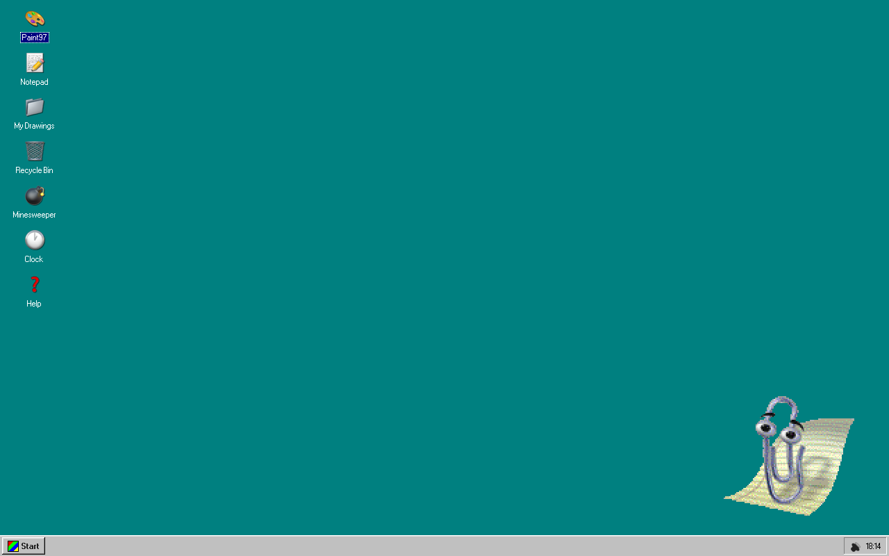
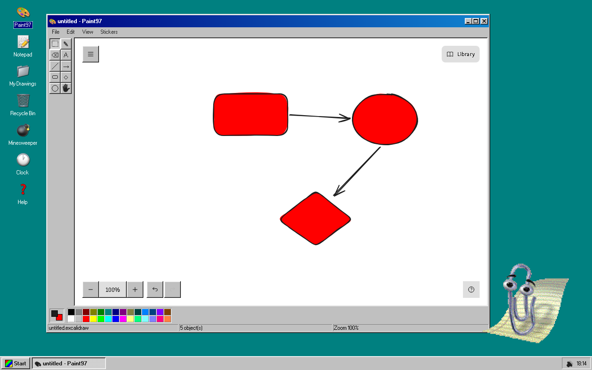
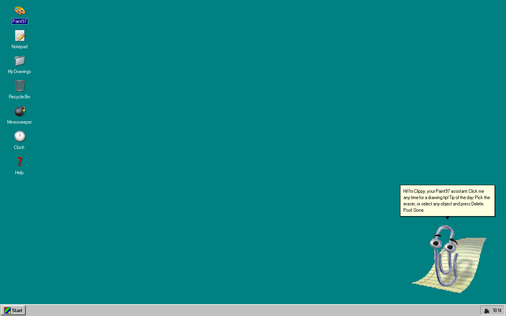
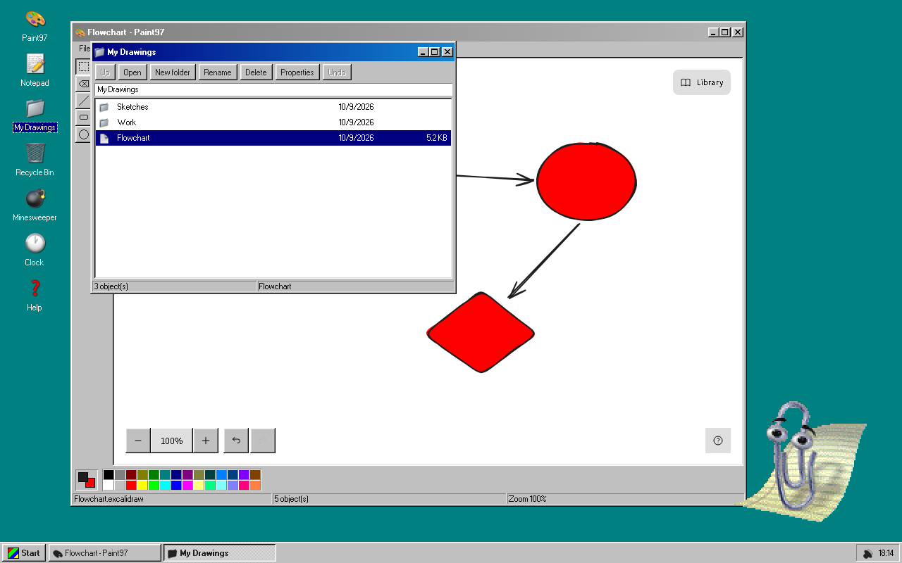

# gitguy/win97-excalidraw (Paint97)

A Windows 9x desktop in the browser, built around an [Excalidraw](https://excalidraw.com) whiteboard. It boots to a teal desktop with draggable windows, a Start menu and a taskbar, and ships Paint97, Notepad, a My Drawings folder with a Recycle Bin, Calculator, Minesweeper, Clock, a Control Panel, and Clippy, who can also chat and draw using a model that runs on your device.

Everything is client-side. There is no backend, no account and no analytics.






## Run it

Needs Node 20.19 or newer (`.nvmrc` pins the version this is built with).

```sh
npm ci
npm run dev        # http://localhost:7891
```

| Command | What it does |
| --- | --- |
| `npm run dev` | Dev server with HMR |
| `npm run build` | Typecheck, production build, generate the service worker |
| `npm run preview` | Serve `dist/` with the production CSP |
| `npm run lint` / `npm run typecheck` | oxlint / `tsc -b` (app, config and tests) |
| `npm run test:unit` | `node --test` over every pure module, no browser |
| `npm run test:e2e` | Playwright against the production build: flows, offline, Clippy cadence, axe, visual |
| `npm run test:visual` | Only the five visual-regression states |
| `npm run check` | lint, typecheck, unit, build, budget, CSP sync, assets |
| `npm run check:budget` | Gzip budgets for first paint and the precached shell |
| `npm run check:csp` | `vercel.json` headers must match the built CSP |
| `npm run model:verify` | Re-hash `models/` against `models/manifest.json` |

## What's in it

- **Desktop shell**: boot screen, six CSS wallpapers, windows that drag, resize, snap to edges, minimise and maximise, with the layout restored on reload. Alt+Tab (or Alt+\` where the browser swallows Alt+Tab) switches windows; the Win key opens Start.
- **Paint97**: Excalidraw behind a Win98 tool strip and 28-colour palette, with the zoom level in the status bar. Open and save `.excalidraw`, export PNG, SVG or a framed PNG, copy the image to the clipboard, drop stickers, and copy a `#scene=` share link that carries the whole drawing in the URL.
- **My Drawings and Recycle Bin**: folders, rename (F2), move by drag or Ctrl+X / Ctrl+V, Properties, Delete to the bin, and Ctrl+Z to undo rename, move, delete and restore. Every save keeps a snapshot; autosave adds one at most every two minutes, ten per drawing, listed under Previous versions. Restoring one first snapshots what it replaces. Drawings can also be dragged between two folder windows.
- **Notepad**: autosave, word wrap, find and replace, `.txt` open and save.
- **Calculator, Minesweeper, Clock**.
- **Control Panel**: wallpaper, volume, Liquid Glass, language (English, Dutch), Clippy on/off, personality and size, reduced motion, and one JSON backup of all local data with import and reset.
- **Clippy**: three personalities, tips that react to what you do (first use of a tool, saving, exporting, an emptied canvas, errors, a long pause), and a tip of the day.
- **Ask Clippy**: chat with Gemma 3 270M running in WebAssembly in the browser. The 253 MB model downloads once, can be paused and resumed, and every part is SHA-256 verified. Replies stream and can be stopped. Clippy may propose one drawing command per reply, and nothing is drawn until you press Apply.
- **PWA**: installable, and an offline reload still works. The service worker precaches the shell only; the model keeps its own cache.

## How it's built

`docs/DESIGN.md` has the reasoning. In short:

- `src/lib/` holds framework-free logic, each module with unit tests: window manager, file-system index, calculator, minesweeper, share codec, backup, settings, model install and its state machine.
- `src/shell/` is the desktop: one window-manager store driving windows, taskbar and switcher.
- `src/apps/registry.ts` is the one table of apps. It drives the desktop icons, the Start menu, taskbar buttons and window content. Adding an app is one component file plus one row.
- `src/clippy/engine.ts` is the Clippy engine: no DOM, no framework. `dom.ts` renders it and `Clippy.tsx` is the React wrapper.

### The choppy rules

Clippy is meant to look like 1998. The engine holds these as constants, not options, and `tests/unit/clippyEngine.test.ts` asserts each one on a fake clock:

1. Frames step on a timer clamped to 8-12 fps. Nothing tweens.
2. No CSS transitions or animations on any Clippy node.
3. Integer pixel scale from 1 to 4, rendered pixelated.
4. `moveTo` is five teleport jumps and an 80 ms freeze.
5. A blink is two frames, every 3-6 s, only while idle.
6. The balloon appears and disappears instantly.

Reduced motion turns off blinking and idle animations and collapses animations and moves to a single step. A hidden tab pauses every timer.

## Security and privacy

- Production CSP: `default-src 'self'`; `script-src 'self' 'wasm-unsafe-eval'` plus one version-pinned path for the Clippy CDN fallback (`cdn.jsdelivr.net/npm/clippyjs@0.1.0/`); `font-src 'self' data:`; `connect-src 'self' https://raw.githubusercontent.com` (model parts only, and only if `/models/` is not served locally); `object-src 'none'`; `frame-ancestors 'none'`. The build embeds the policy as a `<meta>` tag and `vercel.json` carries it as headers; `npm run check:csp` fails if they drift.
- Excalidraw's fonts are self-hosted (copied into `public/fonts` at build time), so no font request leaves the origin.
- Imported scenes, share links, backups and the stored window layout are shape-checked and size-capped before use. Download names are slugified.
- Clippy's sprite and sounds load from the local copy first. The CDN is only tried if the local files are missing.

## Accessibility

Targets WCAG 2.1 AA. The e2e suite runs axe over the desktop, the Start menu, every app window and the dialogs, and checks the keyboard behaviour axe cannot see: roving tabindex in menus, the tool strip and desktop icons, `aria-activedescendant` lists in the folder windows, dialogs that trap Tab, close on Escape and return focus, and focus following the active window. Clippy is a button (Enter for a tip, arrow keys to move him) and announces each message once through a polite live region. Excalidraw's own DOM is upstream and excluded from the axe scan.

## Deploying

`dist/` is a static bundle. A host should send the headers in `vercel.json`; `frame-ancestors` is ignored in a `<meta>` tag. For Ask Clippy on a deployed site, either copy `models/` next to `dist/` so the parts are served from `/models/`, or publish the repository named in `models/manifest.json` so they can be fetched from `raw.githubusercontent.com`.

## Credits and licences

Code: MIT, see [LICENSE](LICENSE). Third-party components, the Clippy assets, the fonts and the Gemma model weights are listed in [NOTICE](NOTICE).
