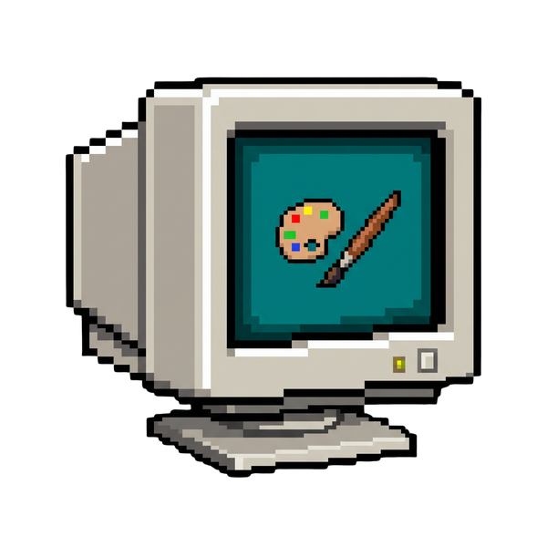
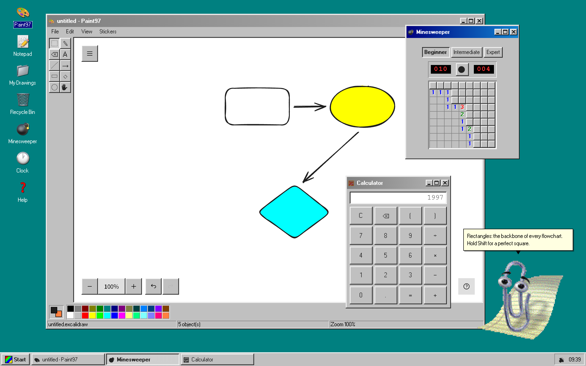

<div align="center">



# Paint97

**A Windows 9x desktop in the browser, built around an [Excalidraw](https://excalidraw.com) whiteboard.**

[Run it](#run-it) · [What's in it](#whats-in-it) · [How it's built](#how-its-built) · [Security and privacy](#security-and-privacy) · [Credits](#credits-and-licences)




</div>

`Gitguy268/win97-excalidraw` boots to a teal desktop with draggable windows, a Start menu and a taskbar, and ships Paint97, Notepad, a My Drawings folder with a Recycle Bin, Calculator, Minesweeper, Clock, JS Paint, a PC Emulator, a Control Panel, and Clippy, who can also chat and draw using a model that runs on your device.

Everything is client-side. There is no backend, no account and no analytics.

<table>
  <tr>
    <td align="center"><br>The desktop</td>
    <td align="center"><br>Paint97</td>
  </tr>
  <tr>
    <td align="center"><br>Clippy with a tip</td>
    <td align="center"><br>My Drawings</td>
  </tr>
</table>

<!-- run-steps:start -->
## Run it locally, step by step

1. **Install [Node.js](https://nodejs.org) 20.19** or newer.

2. **Get the code:**

   ```sh
   git clone https://github.com/Gitguy268/paint97.git
   cd paint97
   ```

3. **Install the dependencies:**

   ```sh
   npm ci
   ```

4. **Start it:**

   ```sh
   npm run dev
   ```

5. **Open <http://localhost:7891/>** in your browser. Press `Ctrl+C` in the terminal to stop.
<!-- run-steps:end -->

## Run it

Needs Node 20.19 or newer (`.nvmrc` pins the version this is built with).

```sh
git clone https://github.com/Gitguy268/paint97.git
cd paint97
npm ci
npm run dev        # http://localhost:7891
```

The first `npm run dev` or `npm run build` also fetches [JS Paint](https://github.com/1j01/jspaint) at a pinned commit, so it needs `git` and access to GitHub. The copy lands in `public/jspaint/` (about 13 MB, not committed) and later runs reuse it.

| Command | What it does |
| --- | --- |
| `npm run dev` | Dev server with HMR |
| `npm run build` | Typecheck, production build, generate the service worker |
| `npm run preview` | Serve `dist/` with the production CSP |
| `npm run lint` / `npm run typecheck` | oxlint / `tsc -b` (app, config and tests) |
| `npm run test:unit` | `node --test` over every pure module, no browser |
| `npm run test:e2e` | Playwright against the production build: flows, offline, Clippy cadence, JS Paint, axe, visual |
| `npm run test:visual` | Only the five visual-regression states |
| `npm run check` | lint, typecheck, unit, build, budget, CSP sync, assets |
| `npm run check:budget` | Gzip budgets for first paint and the precached shell |
| `npm run check:csp` | `vercel.json` headers must match the built CSP |

## What's in it

| Part | What it does |
| --- | --- |
| **Desktop shell** | Boot screen, six CSS wallpapers, windows that drag, resize, snap to edges, minimise and maximise, with the layout restored on reload. Alt+Tab (or Alt+\` where the browser swallows Alt+Tab) switches windows; the Win key opens Start. |
| **Paint97** | Excalidraw behind a Win98 tool strip and 28-colour palette, with the zoom level in the status bar. Open and save `.excalidraw`, export PNG, SVG or a framed PNG, copy the image to the clipboard, drop stickers, copy a `#scene=` share link that carries the whole drawing in the URL, and send the drawing to Paint97 on another device on the same Wi-Fi (File → Send to a device), paired by scanning QR codes. |
| **JS Paint** | [JS Paint](https://github.com/1j01/jspaint), Isaiah Odhner's remake of MS Paint, in a window of its own: pixels, where Paint97 is shapes. It is a self-hosted copy at a pinned commit, not an embed of jspaint.app, so it works offline once it has been opened. The picture is autosaved and comes back when the window is reopened. Clicking in it gives it the keyboard, and Alt+Tab, Alt+\` and the Win key still reach the desktop from inside. Its online features (multi-user sessions, Imgur upload, loading an image from a URL), the camera head tracker and speech recognition are greyed out. Start menu only. |
| **My Drawings and Recycle Bin** | Folders, rename (F2), move by drag or Ctrl+X / Ctrl+V, Properties, Delete to the bin, and Ctrl+Z to undo rename, move, delete and restore. Every save keeps a snapshot; autosave adds one at most every two minutes, ten per drawing, listed under Previous versions. Restoring one first snapshots what it replaces. Drawings can also be dragged between two folder windows. |
| **Notepad** | BrowserFS autosave, word wrap, find and replace, `.txt` open and save. Existing notes migrate automatically and remain part of backup/restore. |
| **Calculator, Minesweeper, Clock** | Three small apps, each in its own window. |
| **PC Emulator** | An x86 PC in a window, running on [v86](https://github.com/copy/v86). It boots a small FreeDOS floppy to an `A:\>` prompt, and **Open disk image…** boots a floppy, hard disk or CD image of your own, which is read locally and never uploaded. Keys go to the emulated PC only while its screen has focus (Ctrl+Alt releases them), and it pauses when another window is active. No sound or networking. |
| **Control Panel** | Wallpaper, volume, Liquid Glass, language (English, Dutch), Clippy on/off, personality and size, reduced motion, and one JSON backup of all local data with import and reset. |
| **Clippy** | Three personalities, tips that react to what you do (first use of a tool, saving, exporting, an emptied canvas, errors, a long pause), and a tip of the day. |
| **Ask Clippy** | Chat with [MiniCPM-V 4.7 1B](https://huggingface.co/openbmb/MiniCPM-V-4.7-1B), which runs on your graphics card through WebGPU (and on the processor where there is none) via a vendored build of [wllama](https://github.com/ngxson/wllama). The 1573 MB model downloads once from Hugging Face and can be paused and resumed. Replies stream and can be stopped. Tick **Look at my drawing** and Clippy sees the canvas as a picture. **Diagram** turns a description ("login flow") into a Mermaid diagram that lands on the canvas as shapes. Clippy may also propose one drawing command per reply. Nothing is drawn until you press Apply. |
| **PWA** | Installable, and an offline reload still works. The service worker precaches the shell only; the model keeps its own cache. |

## How it's built

[docs/DESIGN.md](docs/DESIGN.md) has the reasoning. In short:

- `src/lib/` holds framework-free logic, each module with unit tests: window manager, file-system index, calculator, minesweeper, share codec, backup, settings, the Ask Clippy prompt and command validator, and the model's state machine.
- `src/shell/` is the desktop: one window-manager store driving windows, taskbar and switcher.
- `src/apps/registry.ts` is the one table of apps. It drives the desktop icons, the Start menu, taskbar buttons and window content. Adding an app is one component file plus one row.
- `src/clippy/engine.ts` is the Clippy engine: no DOM, no framework. `dom.ts` renders it and `Clippy.tsx` is the React wrapper.

### The choppy rules

Clippy is meant to look like 1998. The engine holds these as constants, not options, and `tests/unit/clippyEngine.test.ts` asserts each one on a fake clock:

1. Frames step on a timer clamped to 8-12 fps. Nothing tweens.
2. No CSS transitions or animations on any Clippy node.
3. Integer pixel scale from 1 to 4, rendered pixelated.
4. `moveTo` is five teleport jumps and an 80 ms freeze.
5. A blink is two frames, every 3-6 s, only while idle.
6. The balloon appears and disappears instantly.

Reduced motion turns off blinking and idle animations and collapses animations and moves to a single step. A hidden tab pauses every timer.

## Security and privacy

- Production CSP: `default-src 'self'`; `script-src 'self' 'wasm-unsafe-eval'` plus one version-pinned path for the Clippy CDN fallback (`cdn.jsdelivr.net/npm/clippyjs@0.1.0/`); `font-src 'self' data:`; `connect-src 'self' https://huggingface.co https://*.hf.co https://raw.githubusercontent.com` (the Ask Clippy model, its download CDN and its compiled library, fetched only when you ask for the model); `object-src 'none'`; `frame-ancestors 'none'`; `frame-src 'self' https:`. The build embeds the policy as a `<meta>` tag and `vercel.json` carries it as headers; `npm run check:csp` fails if they drift.
- JS Paint is served from this origin under `/jspaint/`, with a policy of its own: it may be framed by this origin only (`frame-ancestors 'self'`), may frame only this origin, and `connect-src 'self' data: blob:` keeps it from reaching any other host. `scripts/copy-jspaint.mjs` removes the requests the upstream page makes to other sites (news screenshots, a Google Fonts import), fails the build if one is left, and disables the menu items that would contact another host or use the camera or microphone. JS Paint keeps its pictures in this origin's localStorage, which holds about 5 MB; **File > Manage Storage** inside it frees space.
- Excalidraw's fonts are self-hosted (copied into `public/fonts` at build time), so no font request leaves the origin.
- Imported scenes, share links, backups and the stored window layout are shape-checked and size-capped before use. Download names are slugified.
- **Send to a device** connects two tabs directly over WebRTC with no STUN or TURN server, so the drawing never passes through another machine, and both devices must be on the same network (guest Wi-Fi that keeps devices apart won't connect). The receiver sees the name and size and accepts before anything is sent, and what arrives goes through the same checks as a file. `Permissions-Policy` allows the camera for this origin only, to scan the other device's code; `/jspaint/` keeps `camera=()`. Where the browser has no `BarcodeDetector`, [jsQR](https://github.com/cozmo/jsQR) reads the code. The ideas come from [LocalSend](https://github.com/localsend/localsend) and [qrcp](https://github.com/claudiodangelis/qrcp), with no code from either.
- Clippy's sprite and sounds load from the local copy first. The CDN is only tried if the local files are missing.
- Ask Clippy runs on this device and sends nothing you type anywhere. Downloading the model is the one request to a third party: it goes to Hugging Face, at a pinned revision. Every 64 MiB of it is checked against a SHA-256 before it is stored.

## Accessibility

Targets WCAG 2.1 AA. The e2e suite runs axe over the desktop, the Start menu, every app window and the dialogs, and checks the keyboard behaviour axe cannot see: roving tabindex in menus, the tool strip and desktop icons, `aria-activedescendant` lists in the folder windows, dialogs that trap Tab, close on Escape and return focus, and focus following the active window. Clippy is a button (Enter for a tip, arrow keys to move him) and announces each message once through a polite live region. Excalidraw's own DOM and JS Paint's are upstream and excluded from the axe scan.

## Deploying

`dist/` is a static bundle. A host should send the headers in `vercel.json`; `frame-ancestors` is ignored in a `<meta>` tag. Paths under `/jspaint/` need the second rule there (`X-Frame-Options: SAMEORIGIN` and `frame-ancestors 'self'`): with the main rule's `DENY`, the JS Paint window stays empty. Ask Clippy needs nothing extra from the host: the browser downloads the model from Hugging Face.

## Credits and licences

The code is MIT licensed, see [LICENSE](LICENSE). That licence covers the code only.

- **Clippy.** The Clippy artwork, animations and sounds in `public/assets/clippy/` belong to Microsoft and are not covered by this project's licence. This project is not affiliated with, endorsed by or sponsored by Microsoft; "Clippy" and the Office Assistants are Microsoft's. The Clippy data and its format come from [pithings/clippy](https://github.com/pithings/clippy) and [smore-inc/clippy.js](https://github.com/smore-inc/clippy.js), both MIT for their code. This project is not affiliated with or endorsed by either of those projects.
- **Model.** The MiniCPM-V 4.7 weights are OpenBMB's, Apache-2.0, and are not in this repository: the browser downloads them from [Hugging Face](https://huggingface.co/openbmb/MiniCPM-V-4.7-1B-gguf).
- **PC Emulator.** [v86](https://github.com/copy/v86) is BSD-2-Clause. The firmware and boot floppy in `public/v86/` are not covered by this project's licence: SeaBIOS is LGPL-3.0 and the FreeDOS kernel and shell are GPL-2.0. [public/v86/README.md](public/v86/README.md) lists each file with its source. No Microsoft operating system is included.
- **JS Paint.** [JS Paint](https://github.com/1j01/jspaint) is MIT, copyright Isaiah Odhner. It is not in this repository: a build fetches it and serves it from `/jspaint/`. JS Paint recreates Microsoft Paint, and the icons, cursors, help pages, sound and translated interface text it ships come from Microsoft's Paint and Windows. They belong to Microsoft and are not covered by this project's licence or by JS Paint's. This project is not affiliated with or endorsed by Microsoft or JS Paint.
- **Fonts.** Each bundled font keeps its own licence, listed in [public/licenses/FONTS.md](public/licenses/FONTS.md).

The classic icons, BrowserFS, RetroBar taskbar adaptation and windows_98.css integration are documented in [docs/RETRO-INTEGRATIONS.md](docs/RETRO-INTEGRATIONS.md).

Every third-party component is listed in [NOTICE](NOTICE). To contribute, see [CONTRIBUTING.md](CONTRIBUTING.md); to report a security problem, see [SECURITY.md](SECURITY.md).
